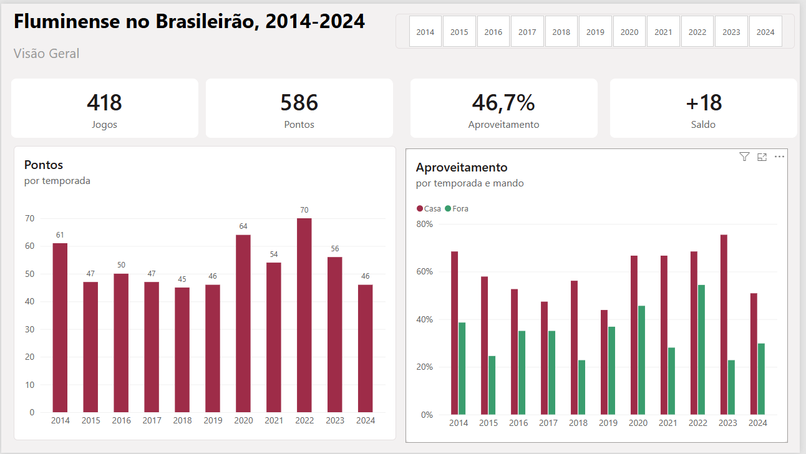
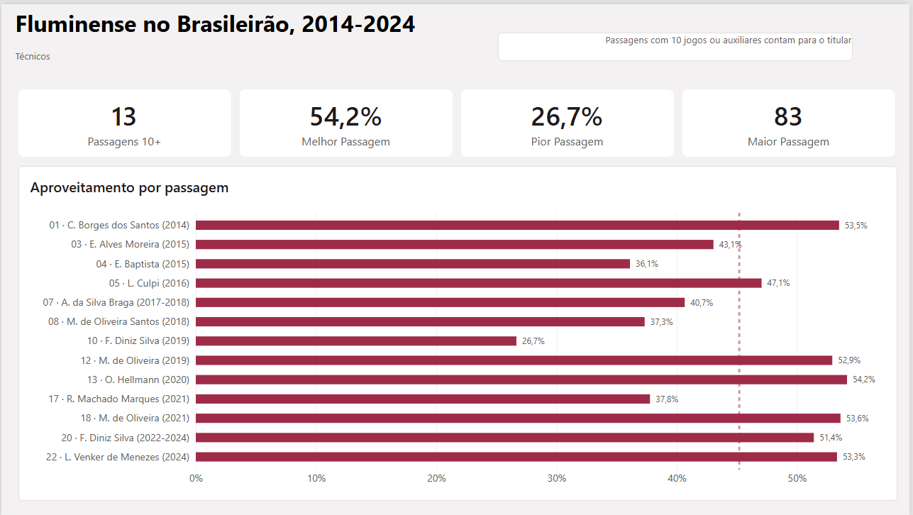
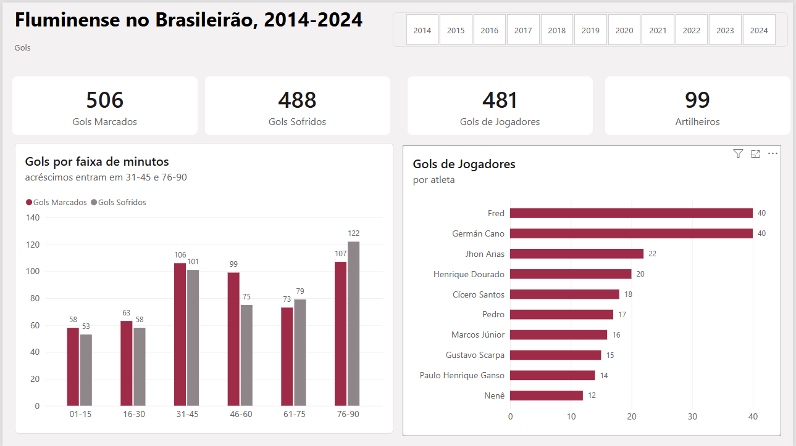
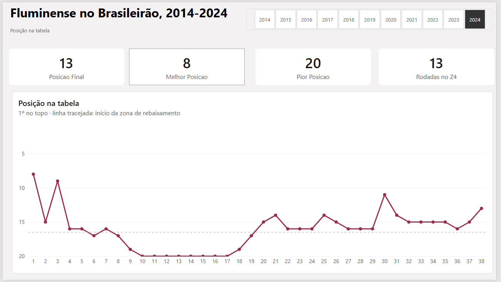

# Fluminense no Brasileirão (2014–2024)

Análise do desempenho do Fluminense no Campeonato Brasileiro Série A de 2014 a 2024, com **MySQL** para tratamento e modelagem dos dados e **Power BI** para o relatório.

   
   
   
   
## Pergunta

**O que explica o desempenho do Fluminense no Brasileirão?**

Dividi a pergunta em quatro análises:

1. **Casa x fora:** o time rende diferente no seu mando de campo?
2. **Técnicos:** como o aproveitamento mudou a cada passagem de treinador?
3. **Gols:** em que momento do jogo o time mais marca e mais sofre, e quem são os artilheiros?
4. **Posição na tabela:** como foi a campanha rodada a rodada em cada temporada?

## Dados

* **Fonte:** [Brasileirao\_Dataset](https://github.com/adaoduque/Brasileirao_Dataset), de Adão Duque (dados públicos do Brasileirão de 2003 a 2024).
* **Arquivos usados:** `campeonato-brasileiro-full.csv` (8.785 partidas) e `campeonato-brasileiro-gols.csv` (9.861 gols).
* **Recorte:** 2014 a 2024, porque o técnico de cada jogo só aparece no dataset a partir de 2014. São **418 jogos** do Fluminense e **994 gols** nesses jogos.

## Ferramentas e técnicas

* **MySQL / MySQL Workbench:** tabelas de staging, modelo com tabelas fato e dimensão, views, CTEs e window functions (`LAG`, `SUM() OVER`, `RANK()`).
* **Power BI:** tabela de dimensão de temporadas, medidas DAX (`CALCULATE`, `FILTER`, `MAXX`, `MINX`, `DISTINCTCOUNT`), filtro Top N, linhas de referência e tema personalizado.

## Fluxo do projeto

```
CSV  →  staging (texto bruto)  →  tabelas tratadas  →  views de análise  →  Power BI
```

|Etapa|Script|O que faz|
|-|-|-|
|1|`sql/criacao/01\_criar\_staging.sql`|Cria o banco e as tabelas de staging|
|2|`sql/criacao/02\_carga\_staging.sql`|Carrega os CSVs no staging|
|3|`sql/criacao/03\_tabelas\_e\_view.sql`|Cria `dim\_time`, `fato\_partida`, `fato\_gol` e a view base dos jogos do Fluminense|
|4|`sql/criacao/04\_views\_powerbi.sql`|Cria as views que o Power BI lê|
|5|`sql/criacao/05\_ajuste\_rotulo\_passagem.sql`|Ajusta o rótulo das passagens de técnico|
|–|`sql/analises/01` a `05`|Consultas de cada análise|

## Tratamento dos dados

Os problemas que encontrei e como resolvi cada um:

* **Temporada 2020:** por causa da pandemia, a temporada terminou em fevereiro de 2021. Usar o ano da data daria 27 jogos em 2020 e 49 em 2021, então os jogos de janeiro e fevereiro de 2021 foram atribuídos à temporada 2020.
* **Importação incompleta:** o assistente de importação do Workbench descartou 1.180 partidas sem mostrar erro. Troquei por uma carga com `INSERT` e passei a conferir a contagem de linhas em cada etapa.
* **Minuto do gol:** vinha como texto (`"90+2"`) e foi separado em minuto e acréscimo.
* **Técnicos auxiliares:** jogos comandados pelo auxiliar enquanto o titular estava suspenso foram atribuídos ao titular, para não quebrar a passagem em vários pedaços.
* **Passagens com o mesmo nome:** duas passagens diferentes do mesmo técnico em 2021 recebiam o mesmo rótulo e se misturavam (60,4% de aproveitamento em vez de 53,6%). Cada passagem ganhou um número, o que também deixou a ordem cronológica.
* **Gols contra:** contam para o Fluminense no placar, mas ficaram fora do ranking de artilheiros, porque o autor é jogador do adversário.
* **Jogo não disputado:** Chapecoense x Atlético-MG, da última rodada de 2016, não aconteceu. Para a classificação rodada a rodada não perder esses dois times, montei uma grade com todos os times em todas as rodadas.

## Principais conclusões

### Casa x fora

!\[Visão geral](imagens/visao-geral.png)

* O aproveitamento foi de **59,5% em casa** e **34,0% fora**.
* Em **2023**, a diferença chegou a **52,6 pontos percentuais** (75,4% em casa, 22,8% fora).
* **2022** foi a única temporada acima de 50% fora de casa (54,4%) e também a de maior pontuação: 70 pontos e 3º lugar.

### Técnicos

!\[Técnicos](imagens/tecnicos.png)

* O melhor aproveitamento entre as passagens com 10 jogos ou mais foi de **Odair Hellmann (54,2%, 2020)**.
* **Fernando Diniz** teve a pior passagem (26,7% em 2019) e uma das melhores (51,4% entre 2022 e 2024).
* A média do período foi de **46,7%**.

### Gols

!\[Gols](imagens/gols.png)

* O fim do jogo é o momento mais frágil: **122 gols sofridos entre os 76 e 90 minutos**, saldo de -15.
* O início do segundo tempo é o melhor momento: **saldo de +24 entre os 46 e 60 minutos**.
* **Fred** e **Germán Cano** marcaram **40 gols** cada. Cano chegou a esse número em 3 temporadas e sem pênaltis; Fred, em 6 temporadas e com 11 pênaltis.
* **99 jogadores** diferentes marcaram no período. Os cinco maiores artilheiros somam 29% dos gols.

### Posição na tabela

!\[Posição na tabela](imagens/posicao.png)

* Em **2024**, o time ficou **8 rodadas seguidas na lanterna** (rodadas 10 a 17) e se recuperou até o 13º lugar.
* Em **2022**, saiu do 16º lugar na rodada 5 para terminar em 3º.
* Em **2016**, chegou a 5º na rodada 27 e terminou em 13º.

## Limitações

* Os dados vão até 2024.
* O dataset não tem escalações, então não dá para medir gols por jogo disputado nem o desempenho do time sem determinado jogador.
* A vantagem em casa não foi comparada com a média do campeonato. Todo time rende mais em casa; a comparação mostraria se o Fluminense depende mais do mando que os outros.
* Jogos adiados contam na rodada original, então algumas posições intermediárias podem diferir da tabela publicada na época.

## Próximos passos

* Incluir a temporada 2025.
* Comparar o efeito casa x fora com a média dos outros times.

## Como reproduzir

1. Baixe os CSVs do [dataset original](https://github.com/adaoduque/Brasileirao_Dataset).
2. No MySQL, execute os scripts da pasta `sql/criacao` na ordem numérica.
3. Abra `powerbi/fluminense\_brasileirao.pbix` no Power BI Desktop. Se o banco estiver em outra máquina, ajuste a conexão em **Transformar dados > Configurações da fonte de dados** e clique em **Atualizar**.

O Power BI precisa do **MySQL Connector/NET** instalado para se conectar ao MySQL.

## Estrutura do repositório

```
├── README.md
├── imagens/          prints das páginas do relatório
├── powerbi/          arquivo .pbix e tema
└── sql/
    ├── criacao/      criação, carga e views
    └── analises/     consultas de cada análise
```

## Autor

**Artur Sant Anna Das Chagas**


Estudante de Sistemas de Informação na UniFOA.


[LinkedIn](https://www.linkedin.com/in/artur-sant-anna/) (https://www.linkedin.com/in/artur-sant-anna/)


*Projeto independente, sem vínculo com o Fluminense Football Club.*

